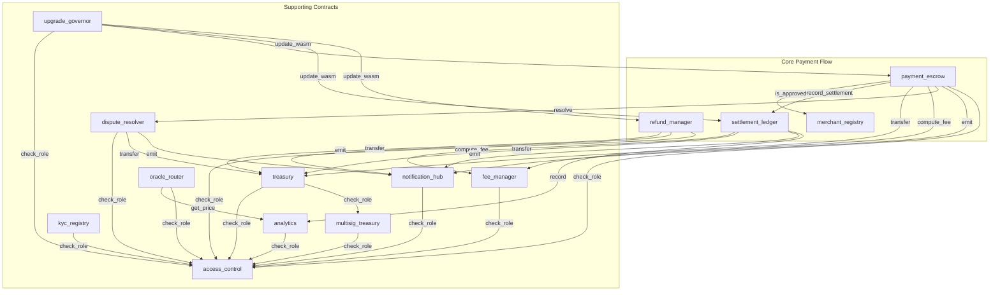
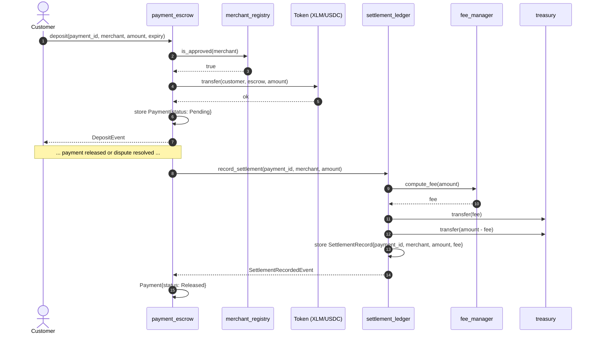

# dabdub_contracts

Soroban smart contracts powering the dabdub payment platform.

## Contract Interaction Diagrams

> **Maintenance note:** These diagrams are part of the contract documentation. Whenever a new cross-contract call is added (a new `#[contractclient]` interface, a new `env.invoke_contract` / client invocation, or a new contract-to-contract data dependency), update the relevant diagram below in the same PR. Reviewers should treat a stale diagram as a documentation bug.

### Contract Call Graph

Shows which contracts invoke which other contracts. Arrows point from caller to callee.

### Payment Escrow Deposit → Settlement Ledger Record (Data Flow)

Shows the data flow when a customer deposits into `payment_escrow` and the escrow later records the settlement in `settlement_ledger`.

